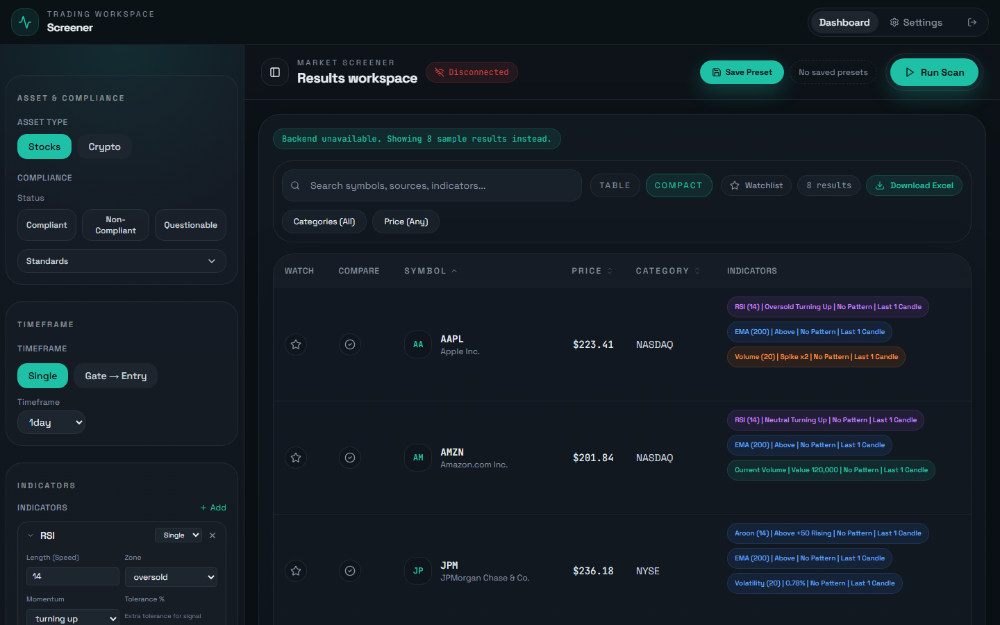
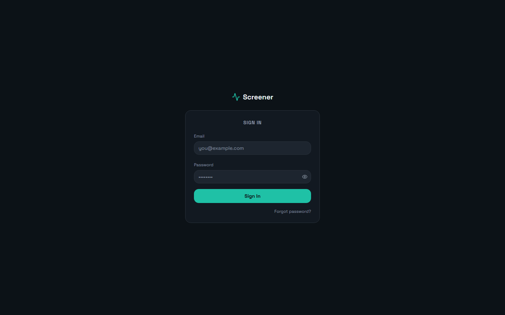
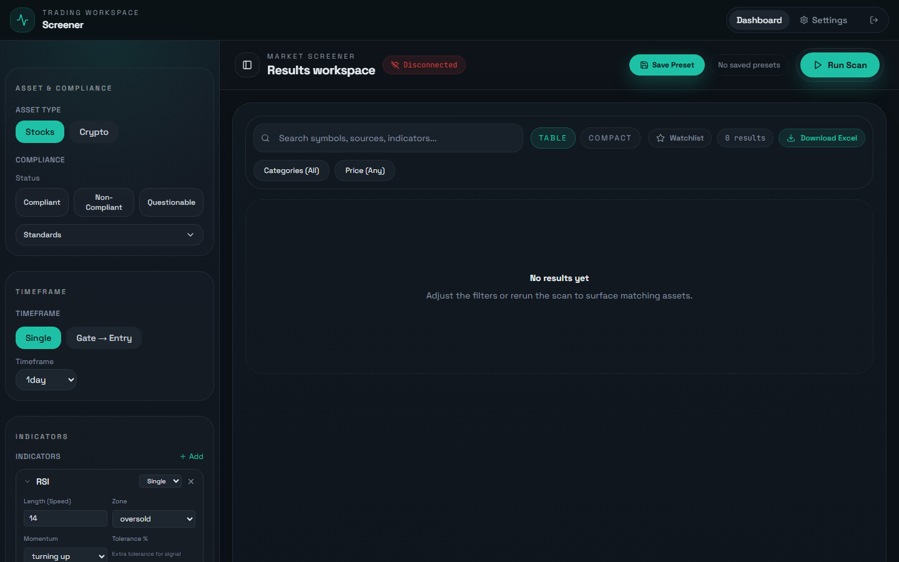
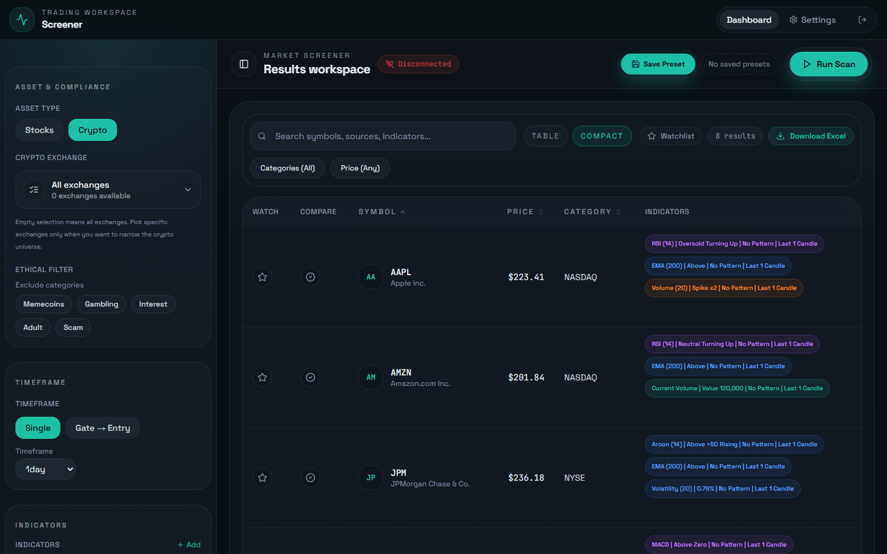
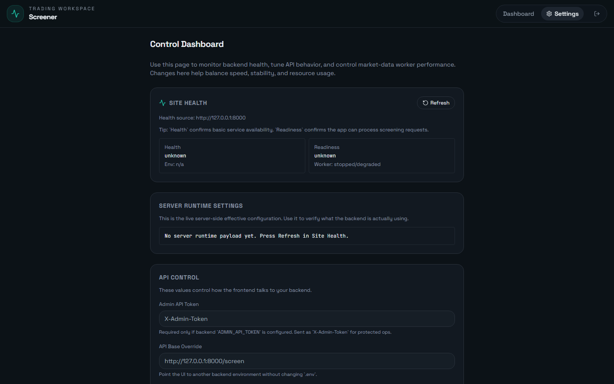

# Technical market screener for halal stocks and crypto

A screening tool for a trader who wants to scan a Shariah-screened stock universe (from Zoya) and a
crypto universe for technical setups: oversold RSI turning up, a touch of a regression channel
line, a WaveTrend cross, a volume spike, and a dozen more, each with its own parameters and
confirmation rules. It can run one timeframe, or a two-step gate-then-entry scan where symbols
that pass on a higher timeframe are re-checked on a lower one. Results come back as a table with
per-indicator "stickers", a detail panel, a compare tray, watchlist and an Excel export. The
frontend is a React app behind Firebase sign-in; the backend is a FastAPI service with a SQLite
candle cache and a background market-data worker.

I built both services end to end for the client, iterating on a written feedback round: the
indicator engine and its sub-filters, the gate/entry workflow, the market-data cache and worker,
the ops endpoints and control dashboard, the filter builder UI, presets in Firestore, tests on
both sides, and the deployment configs for Railway and Netlify.



## What it does

**For the trader**
- Pick stocks or crypto. Stocks carry Zoya compliance status (compliant, non-compliant,
  questionable), report date and purification ratio; crypto can be limited to assets listed on
  chosen exchanges and can exclude memecoins, gambling, interest, adult and scam categories
- Choose a timeframe preset (1m to 1 day) or type a custom one such as `3h` or `2w`, and run in
  single mode or gate-to-entry mode with separate timeframes for each step
- Add any number of indicator blocks and tune each one: RSI, WaveTrend, Aroon oscillator, linear
  regression channel, regression channel, trend channels, linear regression candles, EMA, MACD and
  the volume family (spike, relative volume, current volume, float, shares outstanding,
  volatility)
- Add the two post-filters: channel respect (how many times price has respected a channel line)
  and confluence (two lines or zones agreeing within a short candle window, with an optional
  liquidity sweep)
- Work with results: search, sort, paginate, switch table and compact layouts, star a watchlist,
  compare symbols side by side, open a detail panel, download an `.xls`
- Save, load and delete full filter presets, stored per user in Firestore

**For the operator**
- A control dashboard that checks backend health and readiness, shows the live runtime settings,
  sets the admin token, API base, timeout and retries, and starts, stops, reconfigures or
  force-refreshes the market-data worker
- An editor for every indicator's default parameters

## How a scan runs

1. The backend builds the universe from the local JSON files (`zoya_universe.json`,
   `crypto_universe.json`) and applies the symbol cap
2. Candles for the requested timeframe come from the SQLite cache first; symbols that are missing
   or due for refresh are fetched from the Massive API, and `4h` is aggregated from `1h`
3. Indicators run in order with AND logic and short-circuit on the first failure; multi-line
   rules (channel lines, trend-channel areas) require every selected line to pass
4. Confirmation rules look at the candles after the signal, within the configured window, for
   bullish, bearish, strong bullish or strong bearish patterns
5. Post-filters run, and each row is returned with its metadata and stickers
6. In gate/entry mode the gate stores the passing set in SQLite under a one-time, TTL-bound
   `gate_session_id` that the entry run consumes

## Market data and operations

- **Cache-first with graceful degradation:** snapshots are reused until `next_refresh_at`; if a
  fetch fails the stale snapshot is kept and the refresh is backed off
- **Background worker:** seeds interest rows for every universe symbol and timeframe, refreshes
  due symbols in priority order (1 day first, 1 minute last), prunes stale rows, and can be
  started, stopped and reconfigured at runtime through `/screen/ops/*`
- **Admin protection:** when `ADMIN_API_TOKEN` is set, ops endpoints require an `X-Admin-Token`
  header
- **Health:** `/healthz` for liveness and `/readyz` that returns 503 when the worker is expected
  but not running
- **Offline fallback in the UI:** if the backend cannot be reached, the frontend says so and shows
  built-in sample results so the interface can still be explored

## Stack

| Layer | Choice |
|---|---|
| Backend | Python, FastAPI, Pydantic v2, NumPy, httpx, uvicorn |
| Data | Massive market data API, SQLite candle cache, local Zoya and CoinMarketCap universes |
| Frontend | React 18, TypeScript, Vite, Tailwind, shadcn/ui (Radix), TanStack Query, Recharts |
| Auth and storage | Firebase Authentication (email/password), Firestore for user settings and presets |
| Delivery | Railway configs for both services (`Procfile`, `railway.json`, `serve -s dist`); a Netlify deployment of the frontend was shared with the client |

## Engineering

- **Tests:** 160+ backend tests covering the indicator handlers, confirmation logic, universe
  routing, cache behaviour and indicator defaults; Vitest and Testing Library tests for the
  results table and crypto exchange filter
- **Type-checked builds:** `npm run build` runs `tsc --noEmit` first, and `npm run check` chains
  typecheck, lint and tests
- **Resilient loading:** lazy-loaded routes with Suspense, an error boundary around the shell, and
  a connection badge that polls the backend root on an interval
- **Handoff documentation:** `Documentation.md` (codebase guide) and `CLIENT_DELIVERABLES.md`
  (feature-by-feature logic and feedback coverage) alongside per-service READMEs

## Screenshots

| | |
|---|---|
|  |  |
| Firebase sign-in | Indicator blocks with per-indicator parameters |
|  |  |
| Crypto exchange and ethical filters | Control dashboard: health, runtime settings, worker |

Screenshots show the frontend running locally without the backend, so the results are the app's
own sample data (the banner says so) and the control dashboard shows an unknown health state.
Sign-in was stubbed for the captures.

## Running it locally

```
cd app/app/backend
python -m venv venv && venv\Scripts\activate     # source venv/bin/activate on Linux or macOS
pip install -r requirements.txt
uvicorn main:app --host 0.0.0.0 --port 8000      # http://localhost:8000, docs at /docs

cd ../frontend
npm ci
npm run dev                                      # http://localhost:8080
npm run check                                    # typecheck, lint, tests
```

Backend `.env`: `HOST`, `PORT`, `CORS_ALLOW_ORIGINS`, `MARKET_DATA_WORKER_ENABLED`,
`SCREENING_MAX_SYMBOLS`, `GATE_SESSION_TTL_SECONDS`, `ADMIN_API_TOKEN`, plus the provider keys
(`MASSIVE_API_KEY` or `POLYGON_API_KEY`, `ZOYA_API_KEY`, `COINMARKETCAP_API_KEY`). Frontend `.env`:
`VITE_API_BASE` and the `VITE_FIREBASE_*` values. There is no `.env.example`; the variable names
are listed in each service's README. Real `.env` files were deliberately excluded from this
repository.

## Repository notes

- The code lives in `app/app/` (`backend/` and `frontend/`); `app.zip` is an archive of the same
  tree. `frontend/dist/` is a committed production build.
- `backend/data/zoya_universe.json.bak` is the unfiltered universe before
  `scripts/filter_zoya_universe_by_massive.py` was applied.
